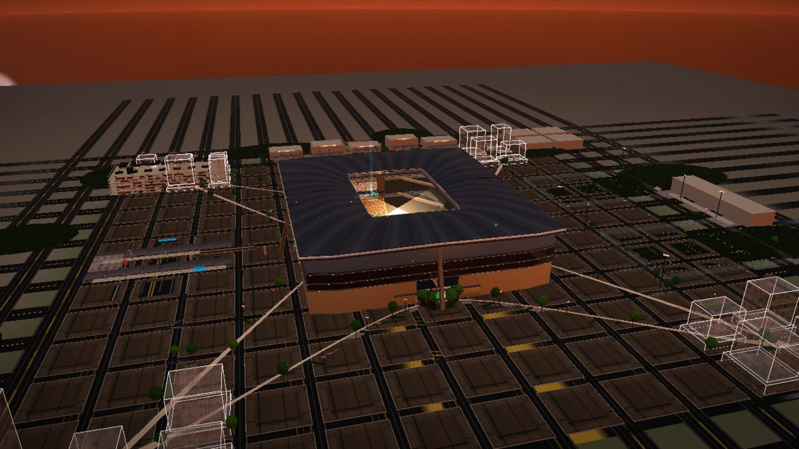

# 潮汐场 TIDAL ARENA · 8 万人专业足球场三维演示

**🌐 在线体验：https://yibaikaishui.github.io/tidal-arena/**

[](https://yibaikaishui.github.io/tidal-arena/)

一个纯前端的 WebGL 三维足球场方案演示：8 万个真实生成的坐席、鞍面悬浮屋盖、四潮八柱、
昼夜光照切换，外加一套可以真的玩的任务系统（漫游取物 → 疏散演练 → 收集徽章 → 建筑洞察）。

> ⚠️ 第一次打开会编译大量着色器，加载页停留几秒是正常的。

**默认就是「轻量模式」**：坐席与绿化减量、关闭泛光、降低渲染分辨率，
让核显/老笔记本也能流畅查看。想要泛光和完整细节，可以在地址后加 `?full=1`，
或在设置面板里关掉「轻量模式」（切换后需刷新）。

如果还是很卡，按 **Shift + P** 看诊断面板确认 GPU 型号；详见 [docs/PERF.md](docs/PERF.md)。

## 怎么玩

| 按键 | 作用 |
|---|---|
| `F` | 第一人称漫游（跟着青色光柱走，走近自动完成当前目标） |
| `P` | 导览机位 |
| `H` | 操作说明 |
| `C` | 照片模式 |
| `Tab` | 展开/收起面板 |
| `B` | 任务简报 |
| `N` | 昼夜切换 |
| `M` | 环境音效 |
| `Shift` + `P` | 性能诊断面板 |

左侧「疏散」面板可用 10 组人力调度 12 个出口，把全馆观众送出；
5 枚建筑徽章散落在广场 / 门厅 / 环廊 / 中圈，收集后会解锁黄昏光照、滤镜与建筑洞察图鉴。

## 本地运行

没有构建步骤，任意静态服务器即可（**不能**用 `file://` 直接打开，ES 模块会被 CORS 拦死）：

```bash
node tools/serve.cjs 8099     # 项目自带的零依赖静态服务器
# 或
python -m http.server 8099
```

然后打开 http://127.0.0.1:8099/

## 目录结构

```
index.html          入口（ES module + importmap）
styles.css          全部样式
src/boot.js         打包入口
src/bundle.js       打包产物（页面实际加载的文件）
src/app.js          启动 / 主循环 / 性能预算 / 诊断面板
src/lib/            渲染主干：core(渲染器/IBL) / postfx(后期) / orbit / walk / modes / textures ...
src/scenes/         arena(场馆) / env(周边场地与城市) / sky(天穹)
src/game/           游戏层：任务 / 徽章 / 疏散 / 建造 / 照片 / 音效
vendor/             three.js r160+ 与字体（不走 CDN，保证离线可用）
docs/               SPEC / PLAYBOOK / CHANGELOG / PERF
tools/              打包、静态服务、验收探针
```

## 改代码后要重新打包

页面加载的是 `src/bundle.js`，不是 `src/*.js` 原始模块（原因见 `tools/bundle.cjs` 头部说明）：
直接改 `src/` 下的模块**不会生效**，必须重新打包：

```bash
cd tools
npm install          # 首次：安装 esbuild 与 playwright-core
node bundle.cjs      # src/boot.js → src/bundle.js
node bundle.cjs --watch   # 或开发时常驻监听
```

## 性能

- 设置面板可开**省电模式**（渲染分辨率减半 + 关泛光 + 关阴影投影，60fps 上限内实测帧率约 +30%）
- URL 参数 `?perf=1` / `?perf=0` 可强制切换档位
- 测量脚本：`cd tools && node perf_bench.cjs`
- 详细数据与下一步优化项见 [docs/PERF.md](docs/PERF.md)

## 许可

仅供演示与学习使用。three.js 遵循其 MIT 许可（见 `vendor/`）。
